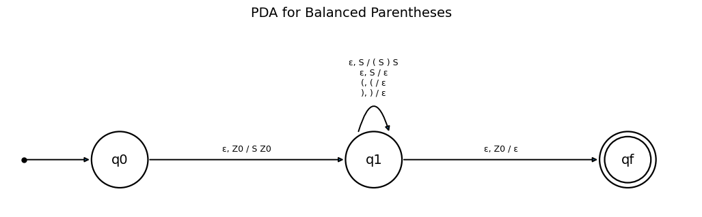
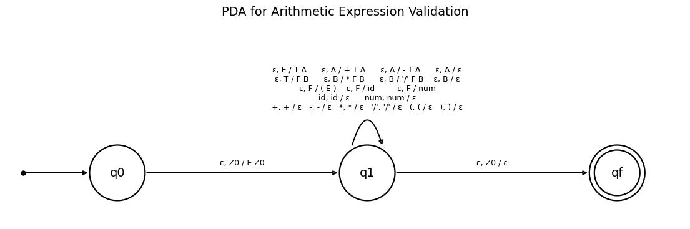
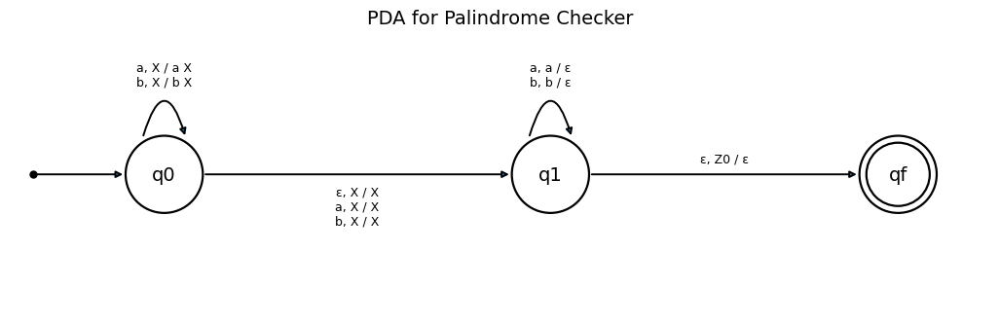

# Formal Languages and Automata Theory – Task 3

This repository contains the implementation of **Context-Free Grammars (CFGs) and Pushdown Automata (PDAs)** using Python.

The task explores grammar construction, PDA transition tables, state diagrams, string validation, derivations, and PDA simulation.

## 📌 Objectives

- Understand Context-Free Grammars and their production rules.
- Design Pushdown Automata for different language patterns.
- Construct PDA transition tables and state diagrams.
- Validate accepted and rejected strings.
- Perform successful and unsuccessful derivations.
- Simulate PDA operations using Python.

## 🧩 Problems Implemented

### 1. Balanced Parentheses

**CFG:**

```text
S → ( S ) S | ε
```

**Implementation:**
- CFG production rules.
- PDA transition table.
- PDA state diagram.
- Python-based parentheses validation.
- Accepted and rejected test cases.
- Successful and unsuccessful derivations.

**PDA State Diagram:**



### 2. Arithmetic Expression Validation

**CFG:**

```text
E → T A
A → + T A | - T A | ε
T → F B
B → * F B | / F B | ε
F → ( E ) | id | num
```

**Implementation:**
- CFG production rules.
- PDA transition table.
- PDA state diagram.
- Arithmetic expression validation.
- Operator precedence and associativity.
- Accepted and rejected expressions.
- Successful and unsuccessful derivations.

**PDA State Diagram:**



### 3. Palindrome Checker

**CFG:**

```text
S → a S a | b S b | a | b | ε
```

**Implementation:**
- CFG production rules.
- PDA transition table.
- PDA state diagram.
- Palindrome validation for strings over `{a, b}`.
- Accepted and rejected test cases.
- Successful and unsuccessful derivations.

**PDA State Diagram:**



## ⚙️ PDA Simulator

A nondeterministic PDA simulator is implemented using Python.

**Features:**
- Breadth-First Search (BFS) over PDA configurations.
- Stack operations and state transitions.
- Epsilon (ε) transitions.
- Acceptance and rejection checking.
- Displays the sequence of PDA configurations for example inputs.
- Compares PDA simulation results with Python validators across the test cases.

## 🛠️ Technologies Used

- Python
- Jupyter Notebook
- Pandas
- Matplotlib
- NetworkX

## 📂 Repository Structure

```text
FLA-Lab-Programs/
│
├── FLA_Task_3.ipynb
├── balanced_parentheses_pda.png
├── arithmetic_expression_pda.png
├── palindrome_checker_pda.png
└── README.md
```

## ▶️ How to Run

1. Clone or download this repository.
2. Open `FLA_Task_3.ipynb` using Jupyter Notebook or Google Colab.
3. Install the required libraries if they are not already installed:

```bash
pip install pandas matplotlib networkx
```

4. Execute the notebook cells in sequential order.
5. Observe the CFG tables, PDA transition tables, state diagrams, validation results, derivations, and simulator outputs.

## 📚 Concepts Covered

- Context-Free Grammar (CFG)
- Pushdown Automata (PDA)
- PDA Transition Functions
- Stack Operations
- Epsilon Transitions
- String Acceptance and Rejection
- Grammar Derivations
- Nondeterministic PDA Simulation

---

**Course:** Formal Languages and Automata Theory (FLA)  
**Task:** Task 3  
**Language:** Python
